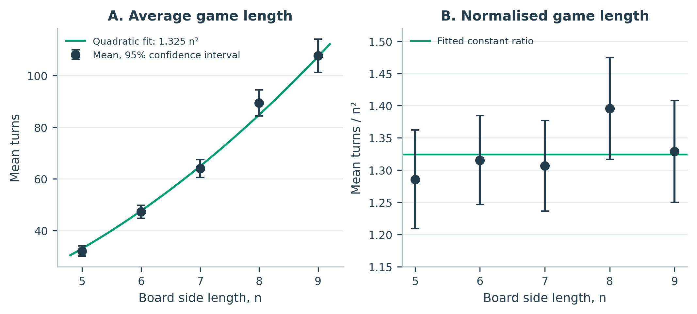
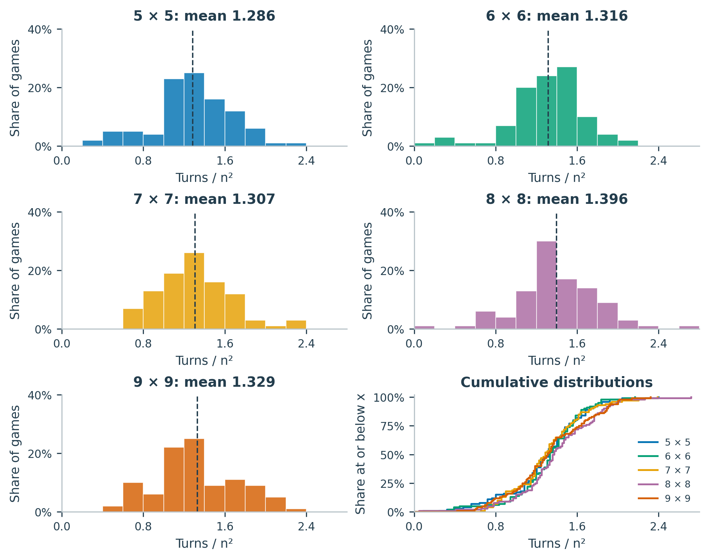
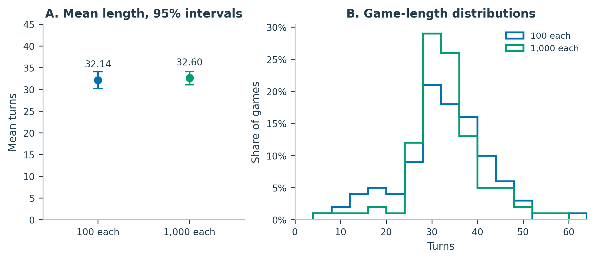
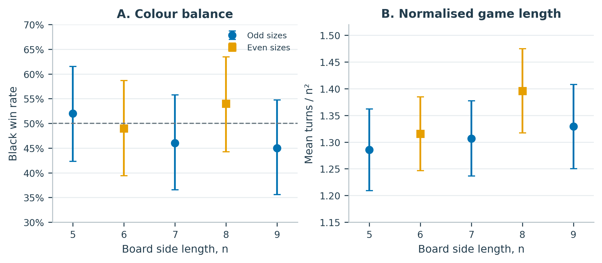
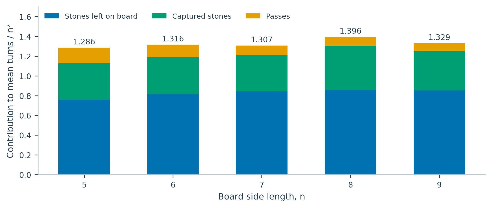

# Board size and search budget in Monte Carlo Tree Search Go agents
James Ward-Phillips | 19 October 2026

James Ward-Phillips   |   19 October 2026   |   Computational project report

## Abstract

A Python Go project was used to investigate board size, game length and Monte Carlo Tree Search (MCTS) search effort. The dataset contains 650 unique completed games: 100 games at each size from 5 × 5 to 9 × 9 with 100 iterations per move, 50 unequal-budget games, and 100 games with 1,000 iterations for both agents. Mean length was compatible with approximately 1.325n² over the tested sizes. The 1,000-iteration agent won 48/50 games against the 100-iteration agent. Increasing both budgets left the mean length similar. The data did not establish a consistent odd/even effect.

## 1. Research questions

**Q1.** How does mean game length vary with board side length n, and is it approximately proportional to n²?**Q2.** How does increasing search effort affect playing strength and game length?**Q3.** Do odd and even board sizes differ after allowing for the general size trend?

## 2. Implementation and experimental design

The project separates Python game logic from a Pygame interface. Simulations use the game state without displaying the board. UCT-based MCTS combines selection, expansion, random rollouts and backpropagation; the underlying exploration idea follows [1]. Budgets below are iterations *per actual move*, not offline training or a fixed time allowance.

| Board | Black / White iterations | Games | Purpose |
| --- | --- | --- | --- |
| 5 × 5 to 9 × 9 | 100 / 100 | 100 each | Board size and parity |
| 5 × 5 | 1,000 / 100 | 25 | Higher budget as Black |
| 5 × 5 | 100 / 1,000 | 25 | Higher budget as White |
| 5 × 5 | 1,000 / 1,000 | 100 | Equal-budget length check |

All games start empty, with Black moving first and 7.5 komi added to White. Orthogonally connected groups share liberties; groups with none are captured. Suicide and repeated board positions after placements are forbidden. Two consecutive passes end a game. Scoring counts stones left on the board plus empty regions bordered exclusively by one colour; mixed or unbordered regions are neutral. There is no automatic dead-stone adjudication. This is the project's simplified area-scoring variant, rather than a full implementation of Chinese tournament rules [2].

---

## 3. Board size and average game length

Figure 1. Mean game length and mean length divided by board area. Each size has 100 games. Error bars are 95% Student t confidence intervals for the mean; they describe uncertainty in the average, not the spread of individual games.

| Board | Mean turns | 95% interval | Mean / n² | Black wins |
| --- | --- | --- | --- | --- |
| 5 × 5 | 32.14 | 30.23 to 34.05 | 1.286 | 52/100 |
| 6 × 6 | 47.36 | 44.88 to 49.84 | 1.316 | 49/100 |
| 7 × 7 | 64.03 | 60.59 to 67.47 | 1.307 | 46/100 |
| 8 × 8 | 89.33 | 84.29 to 94.37 | 1.396 | 54/100 |
| 9 × 9 | 107.65 | 101.27 to 114.03 | 1.329 | 45/100 |

A model proportional to board area was fitted by weighted least squares, with each board-size mean weighted by the inverse of its estimated sampling variance. This gives:

E[T] ≈ 1.325n²

The fitted coefficient has a bootstrap 95% interval of 1.292 to 1.358. An approximate lack-of-fit check gives χ² = 4.58 on four degrees of freedom (p = 0.334). This does not detect a departure from the quadratic model at the available precision.

An exploratory power law E[T] = anp, fitted to the logarithms of the five group means, gives p = 2.090, with bootstrap 95% interval 1.967 to 2.215. The interval includes 2. The elevated 8 × 8 ratio is therefore insufficient to establish growth faster than n². These are finite-range descriptions of these agents on n = 5 to 9, not an asymptotic law of Go.

---

## 4. Distributions of normalised game length

Figure 2. Individual game lengths divided by n². All histograms use the same bins of width 0.2 and show the fraction of games in each bin. Dashed lines mark means. The final panel compares empirical cumulative distributions.

| Board | Median turns | Middle 50% of turns | SD / mean |
| --- | --- | --- | --- |
| 5 × 5 | 33.0 | 27.8 to 38.0 | 0.300 |
| 6 × 6 | 48.0 | 41.0 to 55.2 | 0.264 |
| 7 × 7 | 63.0 | 56.0 to 74.2 | 0.271 |
| 8 × 8 | 87.5 | 76.8 to 106.5 | 0.284 |
| 9 × 9 | 106.0 | 87.5 to 131.5 | 0.299 |

The cumulative curves overlap substantially after division by n². Relative variability, measured by the standard deviation divided by the mean, lies between 0.264 and 0.300 and does not rise consistently with size. These descriptive similarities support using board area as a useful scale, but do not establish identical underlying distributions.

Every valid completed game is retained, including unusually short games. The 6 × 6 and 8 × 8 baseline datasets each contain a game ending after three turns. Very early passes are possible under the agents and scoring variant, and are relevant evidence about their limitations.

---

## 5. Computational budget: strength and length

![Figure 3. Win rate of 1,000 iterations against 100 iterations on 5 × 5. Each colour assignment has 25 games. Horizontal bars are within-colour 95% Wilson intervals [3].](analysis/figures/03_search_budget_strength.png)

Figure 3. Win rate of 1,000 iterations against 100 iterations on 5 × 5. Each colour assignment has 25 games. Horizontal bars are within-colour 95% Wilson intervals [3].

The higher-budget agent won 25/25 as Black and 23/25 as White: 48/50 overall (96%). The within-colour intervals are 86.7% to 100.0% and 75.0% to 97.8%, respectively. This is strong evidence of an advantage in this specific matchup; it does not provide a human Go rank or evidence of optimal play. The same 25 seed labels were used in both colour conditions, so the pooled percentage is descriptive and no independent-binomial pooled interval is claimed.

Figure 4. Equal-budget 5 × 5 games at 100 and 1,000 iterations per move. Each batch contains 100 games. Left: means with 95% Student t intervals. Right: distributions with common four-turn bins.

With both agents increased together, the means were 32.14 and 32.60 turns. The difference, high budget minus low budget, was 0.46 turns, with a Welch 95% interval of -2.01 to 2.93 turns. The data do not show a clear change in mean length; this is not a demonstration of exact equivalence. The sample standard deviation decreased from 9.64 to 8.01 turns, a descriptive observation.

The equal-budget check was only performed on 5 × 5. It cannot establish that the board-size scaling curve is unchanged at higher budgets.

---

## 6. Odd/even sizes and the source of extra turns

Figure 5. Odd and even sizes under 100 iterations per move and fixed 7.5 komi. Win-rate bars are 95% Wilson intervals; length bars are 95% Student t intervals. The horizontal dashed line marks a 50% black win rate.

Black's win rates were 52%, 49%, 46%, 54% and 45% as n increased from 5 to 9. Every within-size confidence interval includes 50%. The larger 8 × 8 length ratio is not mirrored by 6 × 6. To allow for a simple size trend, an exploratory weighted model used E[T]/n² = α + β(n - 7) + γI(even). The estimated even-size effect was γ = 0.045, with bootstrap 95% interval -0.020 to 0.111. This interval includes zero. With only three odd and two even sizes, and a model-dependent adjustment, no consistent parity effect is established.

Figure 6. Mean length decomposed into stones remaining, stones captured and passes, all divided by n². For each game from an empty board, T = final stones + captured stones + passes. The identity was checked in every replay.

On 9 × 9, the average game contained 69.10 stones at the end, 32.20 captured stones and 6.35 passes, summing to 107.65 turns. The 8 × 8 games have the highest captured-stone count per intersection in this dataset. This accounts for an important part of their higher normalised mean, although it does not identify why the agents produced more captures. Game length reflects both board occupancy and the reuse of captured points.

---

## 7. Statistical methods and data handling

Mean intervals use the sample standard deviation divided by √N and a Student t critical value. The equal-budget contrast uses a Welch interval for independent batches. Win-rate intervals use the Wilson method [3]. Model-coefficient intervals use 20,000 bootstrap resamples within each board size [4], analysis seed 20261019, and the original estimated fit weights. These intervals reflect game-sampling variation conditional on the selected models and settings; they do not quantify uncertainty about different algorithms or rules. Exploratory comparisons are not adjusted for multiplicity.

Eleven JSONL files contained 654 records. Two repeated finished records, seeds 19008 and 19009, were excluded after checking that their moves, boards, scores and settings agreed. Two records were search errors, not completed games. The failed 8 × 8 seed 18061 was recovered in the later batch. The failed 9 × 9 seed 19007 was not recovered; the completed 9 × 9 sample instead contains seed 19101. This departure from the initial seed plan is retained explicitly and its potential effect is unmeasured. The old overnight CSV is retained as a reference, not pooled as extra data.

An independent replay checked all 650 finished games plus both failed partial games (38,722 logged turns), including captures, suicide, positional repetition, final passes, board states and area scores. No replay inconsistencies were found. This verifies the recorded games against the defined scoring variant, not the correctness or strength of the MCTS implementation.

## 8. Limitations and conclusion

Fixed iterations do not give equal search coverage as the number of legal choices grows. Random rollouts, early passing and unsettled final positions limit the agents. Komi was fixed rather than calibrated at each size. The scoring variant omits dead-stone agreement/removal used in the referenced Chinese rules [2]. Original engine/MCTS source was not included in the uploaded dataset; the algorithm description and the reported increase in the rollout guard should be checked against that source. The real-game cap of 500 turns is recorded, but the rollout cap is not. Runtime was measured under varying computer loads and is not used as a controlled performance benchmark.

For these agents on 5 × 5 to 9 × 9, mean length is compatible with approximately 1.325n². A tenfold search budget produced a large head-to-head advantage on 5 × 5, while raising both budgets produced little observed change in mean game length. The current sample does not resolve an odd/even effect. Future work could recover the omitted seed, strengthen and audit the agents, test more sizes at several budgets, and calibrate komi through new games.

## References

[1] Kocsis, L. and Szepesvári, C. (2006). Bandit Based Monte-Carlo Planning. ECML, 282-293. [doi:10.1007/11871842_29](https://doi.org/10.1007/11871842_29).

[2] Chinese Weiqi Association (1988 rules), English translation adapted by Davies/Hansen. [The Chinese Rules of Go](https://www.cs.cmu.edu/afs/cs.cmu.edu/Web/People/wjh/go/rules/Chinese.html), sections 8-9. Accessed 19 October 2026.

[3] Wilson, E. B. (1927). Probable Inference, the Law of Succession, and Statistical Inference. JASA 22(158), 209-212. [doi:10.1080/01621459.1927.10502953](https://doi.org/10.1080/01621459.1927.10502953).

[4] Efron, B. (1979). Bootstrap Methods: Another Look at the Jackknife. Annals of Statistics 7(1), 1-26. [doi:10.1214/aos/1176344552](https://doi.org/10.1214/aos/1176344552).
